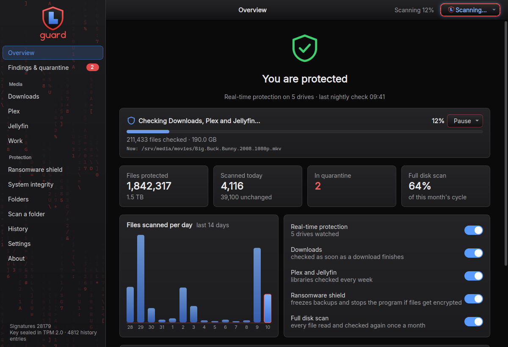
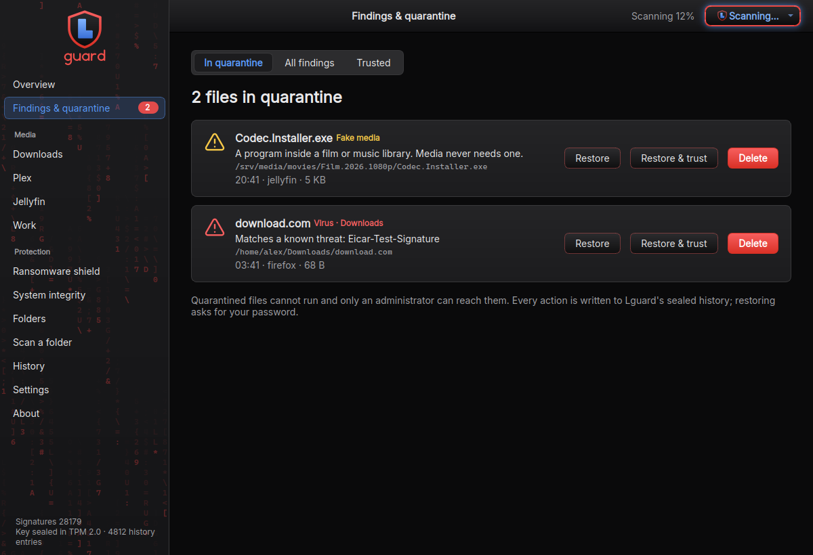
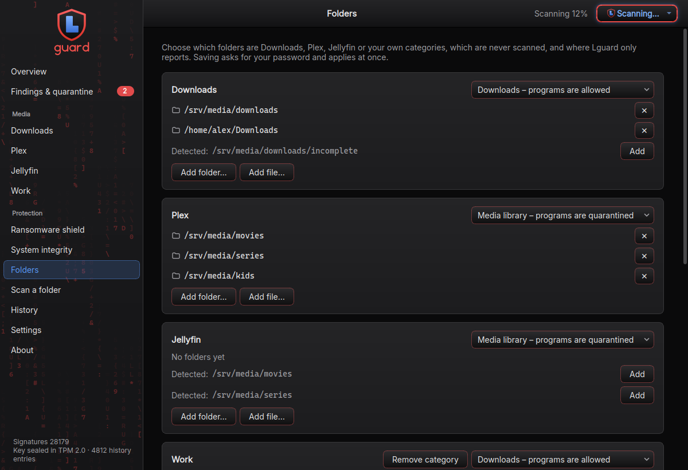

<p align="center">
  
</p>

<p align="center"><b>Antivirus, download guard and ransomware shield for Linux desktops and home servers.</b></p>

<p align="center">
  <a href="https://github.com/lodarco/lguard/releases/latest"></a>
  <a href="LICENSE"></a>
  
</p>

<p align="center">
  <a href="https://github.com/lodarco/lguard/releases/latest/download/lguard_amd64.deb"></a>
  <a href="https://github.com/lodarco/lguard/releases/latest/download/lguard.x86_64.rpm"></a>
</p>

<p align="center">
  
</p>

## Download

| | Protection and scan engine | Desktop app |
|---|---|---|
| **Debian 10+, Ubuntu 20.04+** | [lguard_amd64.deb](https://github.com/lodarco/lguard/releases/latest/download/lguard_amd64.deb) | [lguard-gui_amd64.deb](https://github.com/lodarco/lguard/releases/latest/download/lguard-gui_amd64.deb) |
| **RHEL / Oracle / Alma / Rocky 8+, Fedora** | [lguard.x86_64.rpm](https://github.com/lodarco/lguard/releases/latest/download/lguard.x86_64.rpm) | [lguard-gui.x86_64.rpm](https://github.com/lodarco/lguard/releases/latest/download/lguard-gui.x86_64.rpm) |

A desktop needs both packages; a server only the first. Download them into
one folder, then:

```sh
sudo apt install ./lguard_amd64.deb ./lguard-gui_amd64.deb          # Debian / Ubuntu
sudo dnf install ./lguard.x86_64.rpm ./lguard-gui.x86_64.rpm        # RHEL family / Fedora
```

Every version, with checksums: [all releases](https://github.com/lodarco/lguard/releases).
What changed: [CHANGELOG.md](CHANGELOG.md).

| | |
|---|---|
|  |  |
| Findings and quarantine | Categories: media library or downloads |


Lguard watches every file as it is written or moved into place, keeps a sealed
inventory of what it has checked, looks after your download folders and your
Plex and Jellyfin libraries, and freezes your backups the moment something
starts encrypting your files.

## Features

- **Real-time protection**: fanotify watches whole filesystems; every file
  is checked as soon as it is written, and (Linux 5.9 or newer) as soon as it
  is renamed into place, which is how browsers and download clients finish a
  download. There are no per-directory watch limits. A disk plugged in later
  (a USB stick) is picked up within seconds and checked.
- **Incremental scanning**: the first scan reads every file once. After that
  only changed files are scanned. Identical content found elsewhere (mirrors,
  backups) is recognised by its SHA-256 and not scanned again. New signatures
  are tried on recent programs, archives and documents every night.
- **Full disk scan**: a slice of every disk is read again each night, so
  every file is read from the first byte to the last and checked with the
  current signatures at least once a month. You can also start a full scan by
  hand. Scans can be paused; a pause always ends by itself.
- **Nothing is called clean that was not checked**: archives and disk images
  are scanned whole up to 2 GB. A file the engine could not go through
  completely is recorded as "partly checked" and shown as such.
- **Caches are not a hiding place**: cache, log and database folders are
  skipped for their data, but a program found in one is always scanned.
- **Downloads, Plex, Jellyfin and your own categories**, each either a
  *media library* or a *downloads* folder. In a media library a program is
  quarantined even when no signature knows it: films and music never need
  one. In a downloads folder programs, installers and disk images are normal
  and are scanned like everything else. In both, a name that pretends
  (`Movie.mp4.exe`) or a "video" that is really a program or an archive is
  quarantined.
- **Ransomware shield**: documents that turn into random data, one program
  rewriting hundreds of existing files, or one program deleting documents
  while it writes unreadable files, raise an alarm. Your freeze commands
  (stop sync, stop backup jobs) run so encrypted files cannot overwrite good
  copies, and a program that is not part of the operating system is suspended
  until you decide (`lguard resume-process`, or the button in the app).
- **Quarantine** with restore, restore-and-trust and delete. Trust can be
  taken back.
- **Sealed inventory**: every record is encrypted and authenticated
  (AES-256-GCM, blind HMAC index) and the scan history is a hash chain. The
  key is sealed with `systemd-creds`, bound to the TPM 2.0 chip when the
  machine has one. A record that was copied or edited fails authentication
  and the file is scanned again. See *What the inventory protects against*.
- **System integrity**: Lguard checks its own installation against a shipped
  SHA-256 manifest.
- **Desktop app**: native look (follows the light/dark setting of GNOME or
  KDE), side-of-screen notifications with action buttons, tray icon, desktop
  widget, starts at login. English, German and Spanish.

## Self-contained

Lguard brings its own runtime and does not depend on, or interfere with, the
system's versions of the same software:

| Component | Version |
|---|---|
| Python | 3.12 (python-build-standalone) |
| Scan engine | ClamAV 1.5, built with its own OpenSSL, curl, libxml2, PCRE2, json-c, zlib and bzip2 |
| Desktop app | Qt 6.8 LTS (PySide6, LGPLv3) |

From the system it needs only glibc ≥ 2.28 and systemd. The desktop app also
uses the desktop's own graphics libraries. The scan engine keeps its
signatures in memory: plan for about 1 GB of RAM.

## Supported systems

Debian 10+, Ubuntu 20.04+, RHEL / Oracle Linux / AlmaLinux / Rocky 8+ and
Fedora, x86_64. On systemd older than 250, or without a TPM, the key is kept
in a root-only file instead (`lguard status` shows which).

## Install

See [Download](#download) above. Installing the `lguard` package creates the sealed
key, downloads signatures, starts protection and begins the first scan in the
background at the lowest priority.

Settings are in `/etc/lguard/lguard.toml`. Folders chosen in the app
(categories and their mode, folders the ransomware shield protects, folders
not scanned or report-only) are saved to `/etc/lguard/lguard.d/50-app.toml`.

Out of the box the ransomware shield alarms and suspends the program. To
also protect your backups, tell it what to stop:

```toml
freeze_commands   = ["systemctl stop my-backup.timer", "pkill -STOP -x syncthing || true"]
unfreeze_commands = ["pkill -CONT -x syncthing || true", "systemctl start my-backup.timer"]
```

## Command line

```
lguard status                  state of protection (no root needed)
lguard verify | findings | history
lguard scan <path>...          scan now
lguard sweep [--full]          quick check of changed files / full disk scan
lguard quarantine list | restore <id> [--allow] | delete <id>
lguard trust list | remove <sha256>
lguard freeze | unfreeze       backups and sync (ransomware shield)
lguard resume-process          let a program the shield suspended continue
```

## What the inventory protects against

The inventory answers "was this exact file already checked, and with what
result" without anyone being able to forge the answer by editing the
database: a record that was changed, moved to another file or written without
the key fails authentication, the file is scanned again and the event is
reported. The key never lies on disk in the clear, so a copied or
offline-edited disk gains nothing.

Two limits are worth knowing. A program that already runs as root can read
the key like Lguard itself does. And an old copy of the *whole* state folder
put back in place is accepted: Lguard notices a history that is shorter than
the last one it sealed, but not a database and seal that were rolled back
together. Neither can make a file with changed content pass: the full disk
scan reads every file again and compares it with its recorded SHA-256.

## What Lguard does not do

It does not block a program from starting before it has been scanned: files
are checked within seconds of being written, not at the moment of execution.
Detection of known threats is ClamAV's. The ransomware shield reacts to what
encryption looks like; encryption that keeps file headers intact and leaves
the names alone is not recognised by it.

## Tests

```sh
python3 -m unittest discover -s tests      # needs the "cryptography" module
```

## Building

The build runs in the `manylinux_2_28` container (glibc 2.28), so the result
installs everywhere listed above:

```sh
build/build-clamav.sh     # scan engine and its libraries, from verified sources
build/build-python.sh     # runtime with hash-pinned packages
build/assemble.sh         # /opt/lguard tree, manifest, licence notices
build/package.sh          # .deb and .rpm for lguard and lguard-gui
build/test-install.sh docker.io/library/debian:12 ...   # install and test in clean containers
```

Every build fails if any binary needs a newer glibc than 2.28
(`build/check-glibc.sh`).

## Licence

Lguard is free software under the **GNU General Public License v3.0**
(see [LICENSE](LICENSE)). You may use, study, change and share it, including
your own forks; anything you distribute based on it must stay under the GPL
with its source available.

The repository accepts no outside collaborators; improvements are welcome as
forks. To report a security problem see [SECURITY.md](SECURITY.md).

## Licences of bundled components

ClamAV is GPL-2.0. Qt and PySide6 are LGPL-3.0; they ship as replaceable
shared libraries, and Lguard never refuses to run with a replaced Qt. Only
LGPL Qt modules are used. Python is under the PSF licence; OpenSSL under
Apache-2.0; the rest under permissive licences. Details and source links are
in `/opt/lguard/licenses` and `/opt/lguard/gui/licenses`.
